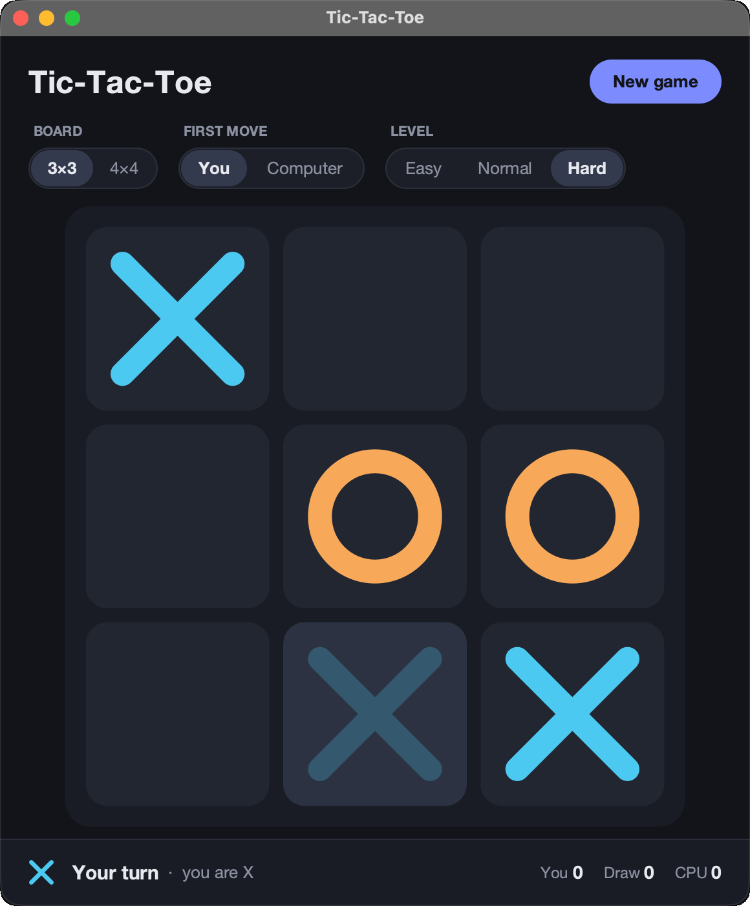
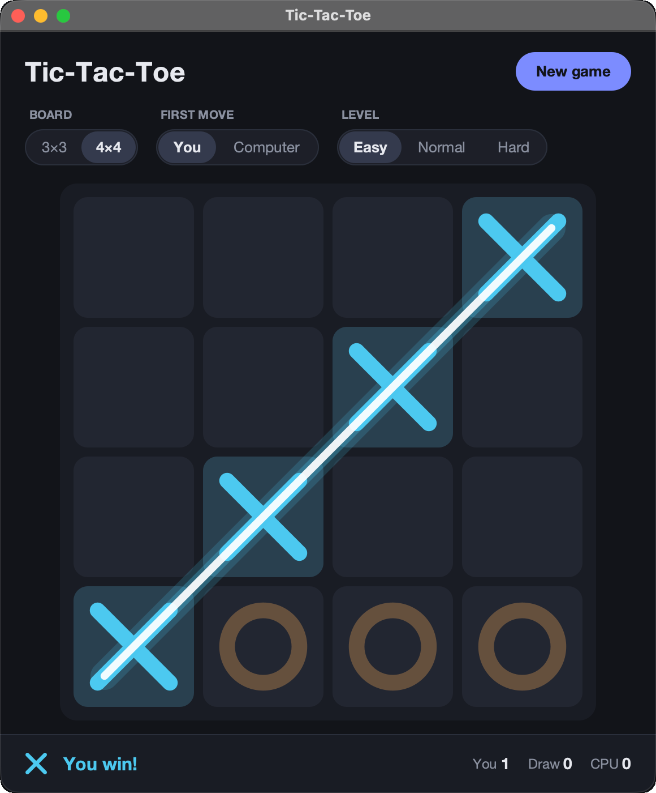
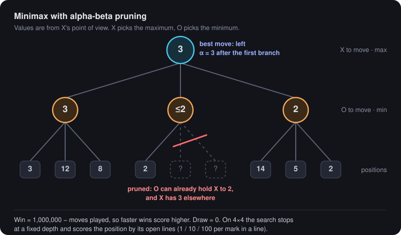
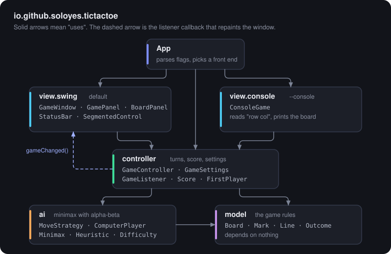
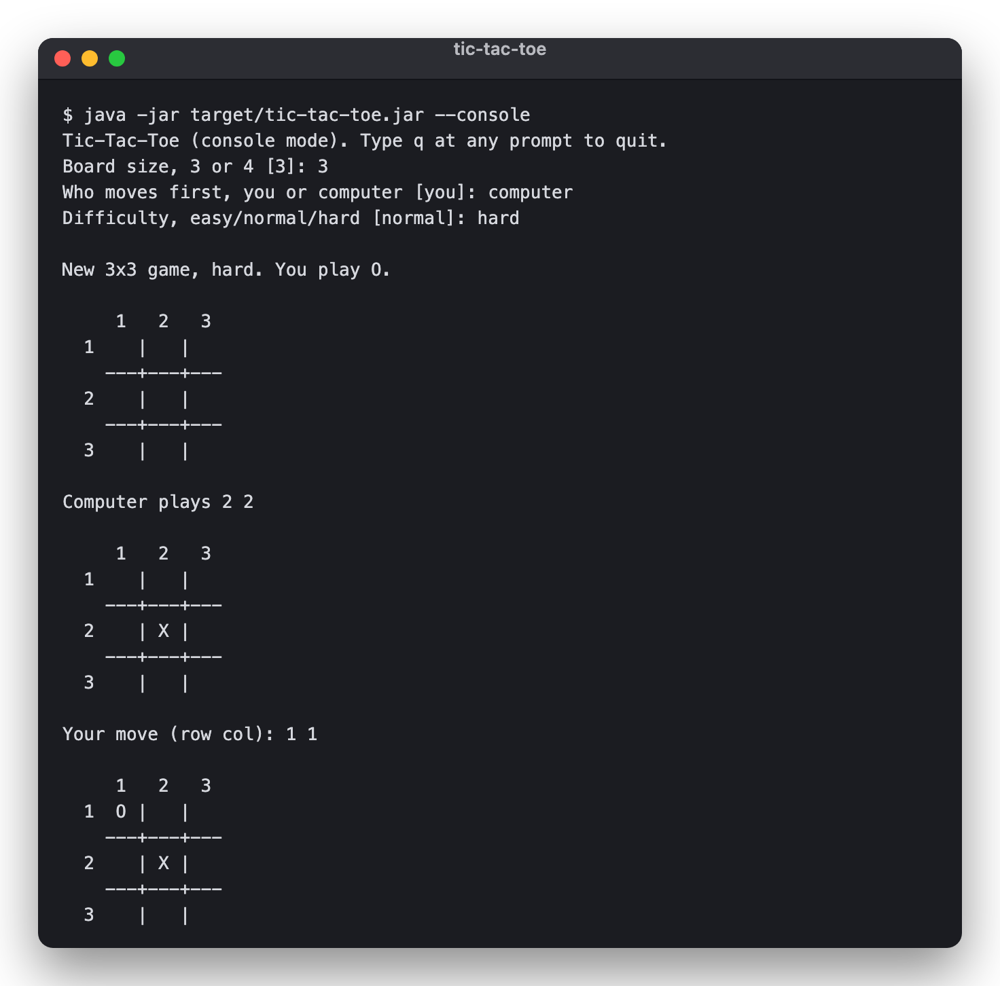

# Tic-Tac-Toe

[](https://github.com/soloyes/tic-tac-toe/actions/workflows/ci.yml)

[](LICENSE)

Tic-tac-toe on 3×3 and 4×4 boards against a computer that uses minimax with alpha-beta pruning.
On Hard it cannot be beaten on 3×3, and a test plays every possible game to prove it.
Plain Java 17 and Swing, no runtime dependencies.

<p align="center">
  
  &nbsp;
  
</p>

## Features

- A Swing window with a dark theme: antialiased marks, a preview of your move when you hover a cell, the winning line drawn across the board, and a status bar with the turn, the result and the session score.
- 3×3 or 4×4 board. A full row, column or diagonal wins.
- You choose who moves first. Whoever opens plays X.
- Three levels:

  | Level  | What it does | 3×3 search | 4×4 search |
  |--------|--------------|------------|------------|
  | Easy   | Random move 60% of the time, otherwise the best move it sees | 2 plies | 2 plies |
  | Normal | Random move 20% of the time, otherwise best play | full game | 4 plies |
  | Hard   | Always the best move | full game, unbeatable | 6 plies |

- A console mode (`--console`) on the same game logic.
- Moves are instant. A full 3×3 search visits about 16.5k positions, and the opening move on an empty 4×4 board at depth 6 takes about 0.1 s.

## How the AI works

<p align="center">
  
</p>

[`Minimax`](src/main/java/io/github/soloyes/tictactoe/ai/Minimax.java) is a negamax search with alpha-beta pruning.

1. Minimax. The computer tries each free cell, then each reply, and so on until the game ends. A position's value is the best the side to move can force: X maximises and O minimises. In negamax form that is one function, where a position's value for one side is minus its value for the other.
2. Alpha-beta pruning. The search keeps two bounds: α is what the mover is already guaranteed elsewhere, and β is the most the opponent will allow. When a branch can no longer beat α, the rest of it is skipped. In the diagram, O's first reply in the middle branch already holds X to 2, while X has 3 on the left, so the other two replies are never searched. From the empty 3×3 board, plain minimax visits 549,945 positions. This search visits 16,553.
3. Move ordering. Centre first, then corners, then edges. Strong moves come early, so cut-offs come early.
4. Scoring. A win is worth `1,000,000 − moves played`, so the AI goes for the fastest win and, when it is losing, the longest defence. A draw is 0.
5. Depth limit on 4×4. A full 4×4 game tree is too big to search on every move, so the search stops after a few plies and [`Heuristic`](src/main/java/io/github/soloyes/tictactoe/ai/Heuristic.java) scores the position. Each line that only one side can still complete counts 1, 10 or 100 for that side, depending on how many marks it already has. Lines that hold both marks are dead and count nothing.
6. Variety. Every root move gets an exact score, and the computer picks at random among the equally best ones. Hard does not play the same game every time and still never makes a mistake.

[`HardAiNeverLosesTest`](src/test/java/io/github/soloyes/tictactoe/ai/HardAiNeverLosesTest.java) checks the "unbeatable" claim exhaustively. The opponent tries every legal move at every turn, and the AI is allowed every move it rates as best. That covers 10,640 complete games with the AI as X and 6,112 with the AI as O. The AI loses none of them.

## Architecture

<p align="center">
  
</p>

The 2017 version kept all game state in static fields shared by every class. The rewrite keeps the original MVC split, but state now lives in objects:

- `model` holds the rules: `Board`, `Mark`, `Line`, `Outcome`. It depends on nothing else.
- `ai` contains `Minimax`, the `Heuristic`, `Difficulty`, and `ComputerPlayer`, which implements the `MoveStrategy` interface.
- `controller.GameController` runs one session: the board, whose turn it is, and the score. It tells listeners about every change. It never moves for the computer on its own. The view calls `playComputerMove()`, so Swing can add a short "thinking" pause while the console plays immediately.
- `view.swing` and `view.console` are two front ends on the same controller.

## Build and run

You need JDK 17 or newer and Maven 3.6 or newer.

```bash
mvn package                          # compile, run the tests, build target/tic-tac-toe.jar
java -jar target/tic-tac-toe.jar     # window (default)
java -jar target/tic-tac-toe.jar --console
java -jar target/tic-tac-toe.jar --size=4 --first=computer --level=hard
java -jar target/tic-tac-toe.jar --help
```

In the window, press `N` (or Cmd/Ctrl+N) or click **New game**. Changing the board size or who moves first starts a new game. Changing the level applies right away.

In the console, enter moves as `row col` (for example `2 3`), or `q` to quit.

<p align="center">
  
</p>

## Tests

```bash
mvn test        # unit tests
mvn verify      # what CI runs
```

The suite covers:

- win detection on every row, column and diagonal of 3×3 and 4×4, for both marks
- draws, and a win on the last free cell
- AI tactics: take a win, block a loss, avoid the corner trap
- the exhaustive Hard-never-loses proof
- 4×4 move speed
- controller turn order and score
- mouse-to-cell mapping in the Swing panel
- a scripted console game

All Swing components are lightweight, so the window content can also be painted without a display. `ScreenshotsTest` does that and writes PNGs; it only runs when you pass `-Dscreenshots=<dir>`.

## History

Started in 2017 as a Java learning project, finished in 2026. The first version was a random-move game with a placeholder AI and a few GUI bugs. This version adds a Maven build, a real minimax AI, the new UI, tests and CI. The old code is still in the git history.

## License

[MIT](LICENSE) © 2017-2026 Vitalii Solovev
